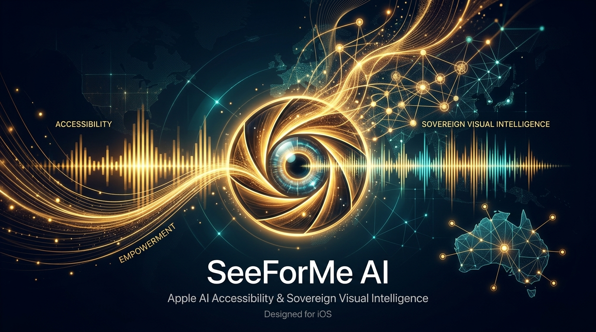

# SeeForMe AI — *See the World Through Sound.*
### 🇦🇺 Built for the Sydney Mobile AI Hackathon (AI On Apple — Sydney)

<p align="center">
  
</p>

> **Sovereign Multimodal AI Assistant for Apple Platforms**  
> Empowering Blind & Low-Vision Accessibility and Enterprise Workplace Safety with **Apple On-Device Intelligence**, **SCX Sovereign Cloud Inference**, and **ElevenLabs Conversational Voice AI**.

---

## 🏆 Hackathon Tracks & Prize Alignment

| Hackathon Prize | Qualification & Implementation in SeeForMe AI |
|---|---|
| **Best Project Built with SCX** | Direct integration with **SCX Sovereign AI Infrastructure** (Sydney cluster `au-syd-1`) via `SCXVisionProvider`. Guarantees 100% Australian data residency with SCX Foundation Models. |
| **Best Project Built with ElevenLabs** | Lifelike conversational speech output powered by `ElevenLabsService` using the ultra-low latency `eleven_turbo_v2_5` model, curated voices (Rachel, Antoni, Adam, Bella), and smart audio caching. |
| **Best Community / Social Good Project** | Autonomous visual companion for blind and low-vision Australians: real-time scene description, Sydney transport (Opal cards, Metro, Sydney Trains), Australian banknotes (AUD $5–$100), and medication reading. |
| **Best Enterprise Solution** | Industrial field inspection & safety auditor: analog pressure gauge reading, PPE & WHS compliance checks, machinery asset tag transcription, and shipping cargo manifest audits. |

---

## 🌟 Key Features & Intelligence Architecture

```
                                  SeeForMe AI
                 (iOS 17+ │ iPadOS 17+ │ macOS │ visionOS Ready)
                                      │
          ┌───────────────────────────┼───────────────────────────┐
          ▼                           ▼                           ▼
  【Apple On-Device AI】      【SCX Sovereign Cloud】     【ElevenLabs Voice AI】
   • Apple Neural Engine       • Sydney Cluster (au-syd-1) • Ultra-Low Latency Turbo
   • Apple Vision OCR          • SCX Foundation Models     • Curated Voice Library
   • Real-Time Offline Mode    • 100% Data Sovereignty     • Zero-Latency Audio Cache
```

### 1. Dual-Track Experience Switcher
- **Community Impact Mode:** Designed VoiceOver-first for blind and low-vision independence.
  - Real-time scene description & spatial awareness.
  - On-device text & document reading with intelligent paragraph chunking.
  - Australian currency identification (AUD $5, $10, $20, $50, $100 polymer notes with tactile features).
  - Sydney Public Transport & Opal reader sign identification (Sydney Trains, Metro, Light Rail, Ferries).
  - Medicine bottle reading with strict safety cautions.
- **Enterprise Mode:** Unglamorous field worker workflows that businesses pay to solve.
  - **Gauge & Meter Reader:** Reads analog needle dials, digital pressure displays, and status indicators.
  - **Workplace PPE & Safety Audit:** Verifies high-visibility vests, hard hats, safety glasses, and detects blocked exits or trip hazards under Australian WHS guidelines.
  - **Asset Tag Inspector:** Extracts machinery serial numbers, model tags, and calibration dates.
  - **Shipping Manifest Auditor:** Audits bills of lading and cargo packaging against delivery notes.

### 2. Three-Tier Multimodal Intelligence
1. **Tier 1: Apple On-Device Intelligence (100% Private & Offline)**
   - Powered by `OnDeviceVisionProvider` running on the Apple Neural Engine.
   - Utilizes `VNClassifyImageRequest`, `VNDetectFaceRectanglesRequest`, `VNGenerateAttentionBasedSaliencyImageRequest`, and `VNRecognizeTextRequest`.
   - Operates in complete airplane mode with zero external connectivity.
2. **Tier 2: SCX Sovereign AI Cloud Inference (Sydney, Australia)**
   - Powered by `SCXVisionProvider` connecting directly to SCX sovereign infrastructure (`https://api.scx.ai/v1/chat/completions`).
   - Complies with Australian Privacy Principles (APP) with strict `au-syd-1` data residency.
   - Foundation models optimized for multimodal vision, spatial reasoning, and Australian context.
3. **Tier 3: ElevenLabs Conversational Voice AI**
   - Human-quality speech synthesis via `ElevenLabsService` utilizing `eleven_turbo_v2_5`.
   - Integrated audio caching for instant playback of frequent accessibility announcements.
   - Automatic, graceful fallback to native `AVSpeechSynthesizer` if offline.

### 3. Fail-Safe Stage Demo Mode
- Integrated **Stage Demo Mode** in Settings provides guaranteed, instant deterministic responses for the 90-second live presentation on stage, completely immune to conference Wi-Fi fluctuations.

---

## 📱 Multi-Platform Apple Support
- **iPhone (iOS 17+):** Handheld assistive companion with haptic feedback and VoiceOver optimization.
- **iPad (iPadOS 17+):** Adaptive split-view layout for enterprise document auditing.
- **Mac (macOS 14+ via Mac Catalyst):** Desktop field inspection log review and asset management.
- **Apple Vision Pro (visionOS Ready):** Spatial computing layout for hands-free assistive sight.

---

## 🚀 Setup & Build Instructions (macOS, Xcode 15.4+ / 16)

### Prerequisites
Install [XcodeGen](https://github.com/yonaskolb/XcodeGen):
```bash
brew install xcodegen
```

### Generating the Xcode Project
```bash
cd SeeForMeAI
xcodegen generate
open SeeForMeAI.xcodeproj
```

### Configuration & API Keys
1. **In-App Settings (Recommended):**
   - Run the app on device or simulator.
   - Tap **Settings** (gear icon).
   - Enter your **SCX API Key** (receives A$100 attendee credit).
   - Enter your **ElevenLabs API Key** (receives US$22 attendee credit).
   - Keys are encrypted and stored in the **iOS Keychain** (`kSecClassGenericPassword`).
2. **Or via Configuration File (Dev only):**
   - Copy `Config/Secrets.sample.xcconfig` to `Config/Secrets.xcconfig` (git-ignored):
     ```xcconfig
     SCX_API_KEY = scx-your-api-key
     ELEVENLABS_API_KEY = xi-your-api-key
     ANTHROPIC_API_KEY = sk-ant-your-api-key
     ```

### Running Unit Tests
Press **⌘U** in Xcode or run:
```bash
xcodebuild test -scheme SeeForMeAI -destination 'platform=iOS Simulator,name=iPhone 16 Pro'
```
Includes dedicated test suites:
- `SCXVisionProviderTests.swift`: Validates Australian sovereign headers, multimodal payloads, and response parsing.
- `OnDeviceVisionProviderTests.swift`: Validates 100% offline on-device analysis and error boundaries.
- `ElevenLabsVoiceTests.swift`: Validates voice catalog, turbo streaming parameters, and request structure.
- `AssistantServiceTests.swift`: Validates dynamic provider resolution, privacy consent, and offline handling.
- `FeatureAndQualityTests.swift`: Validates all 56 catalog features, safety cautions, and image quality analysis.

---

## 🎤 90-Second Live Demo Presentation
See [`docs/LIVE_DEMO_PITCH.md`](docs/LIVE_DEMO_PITCH.md) for the exact step-by-step stage script, timing, and judging criteria mapping.

See [`docs/DEVPOST_SUBMISSION.md`](docs/DEVPOST_SUBMISSION.md) for the complete Devpost write-up.

See [`docs/ARCHITECTURE.md`](docs/ARCHITECTURE.md) for detailed technical architecture and data flow diagrams.

---

## 🔒 Responsible AI & Safety Guardrails
SeeForMe AI is built on uncompromising ethical principles:
- **No False Safety Assurances:** The system prompt forbids claiming paths or floors are obstacle-free or safe to traverse.
- **Explicit Separation of Uncertainty:** Inferences and visual ambiguities are isolated in a distinct `uncertainty` field.
- **Privacy by Design:** Photos are processed on-device by default; remote sovereign analysis requires explicit user consent.
- **Zero Facial Recognition Storage:** Human presence detection counts individuals without biometric identification.
