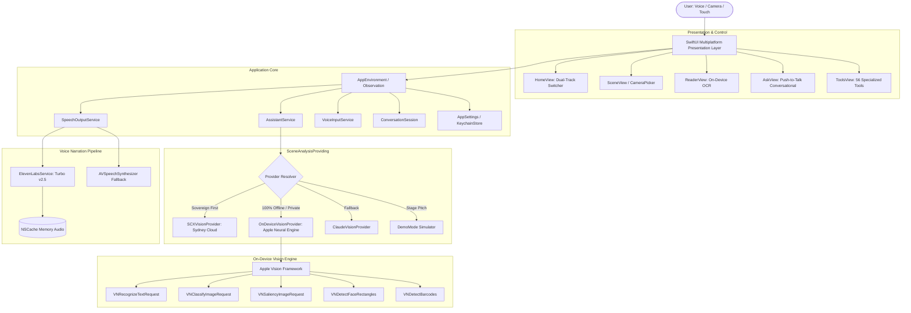

# Technical Architecture: SeeForMe AI

## 📐 High-Level Architecture Overview

---

## 🛡️ Data Sovereignty & Privacy Isolation

| Layer | Network Status | Privacy Guarantee |
|---|---|---|
| **Text Reading (OCR)** | Strictly Offline | 100% On-Device (Apple Neural Engine). Text never leaves the device. |
| **Local Scene Analysis** | Strictly Offline | Real-time classification on device without internet connectivity. |
| **Sovereign Cloud Analysis** | HTTPS (`au-syd-1`) | Routed exclusively to SCX Sovereign AI Cloud in Sydney, NSW. Full Australian data residency. |
| **Voice Narration** | Optional HTTPS | Text-only sent to ElevenLabs API; audio cached locally. Fallback to native synthesizer during network disconnects. |
| **Secrets & Keys** | Encrypted On-Device | Stored in iOS Keychain (`kSecClassGenericPassword`). Never logged or exported. |

---

## 📱 Hardware & Platform Support
- **Apple iPhone (iOS 17+):** Primary handheld assistive companion.
- **Apple iPad (iPadOS 17+):** Adaptive split-screen layout for desk-bound enterprise review.
- **Mac Catalyst & Apple Silicon Mac (macOS 14+):** Field reporting and industrial document verification.
- **Apple Vision Pro (visionOS Ready):** Spatial canvas with hands-free camera and voice control.
